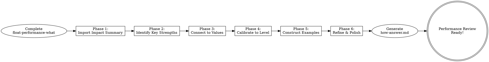

|-------|------|------------|
| **1. Import** | Load impact summary from WHAT | Foundation for strength analysis |
| **2. Identify Strengths** | Discover 2-3 core competencies | Key strengths with evidence |
| **3. Connect to Values** | Map work to Float's 6 values | Behavioral examples per value |
| **4. Calibrate Level** | Assess against leveling framework | At-level or above-level evidence |
| **5. Construct Examples** | Build 1-2 narrative examples | Complete stories with strengths + values |
| **6. Refine** | Polish and validate | Final `how-answer.md` in dated folder |

**Process Flow:**

---

## What You'll Accomplish

By the end of this process, you'll have:
1. **2-3 key strengths** clearly identified and evidenced
2. **Your work connected** to Float's 6 core values with behavioral examples
3. **Level calibration** showing you're operating at or above your level
4. **1-2 compelling narrative examples** that tie it all together

---

## The Process

### Phase 1: Import Your Impact Summary

**Start here:**

Share the impact summary you created in **float-performance-what**. This is your foundation.

The AI assistant will use this to help you identify patterns, strengths, and connections to values and level expectations.

**What to share:**
- Your complete impact summary from float-performance-what
- Include the outcomes, metrics, and business impact areas you documented

**If you skipped float-performance-what:**
You can still use this skill, but you'll need to provide a summary of your major outcomes and deliverables from the review period.

---

### Phase 2: Identify Key Strengths

**Goal:** Discover the 2-3 core competencies that enabled your impact.

#### Step 2.1: Map to Float's Core Competencies

For each high-impact outcome from your summary, identify which competency areas you demonstrated:

**Float's 4 Core Competencies:**

1. **Execution**
   - How you scope, plan, and deliver work
   - How you use data, tools, and structured thinking
   - How you balance speed with quality
   - How you handle complexity and ambiguity

2. **Communication & Judgment**
   - How you synthesize information and create clarity
   - How you make decisions with incomplete information
   - How you communicate context and tradeoffs
   - How you surface risks and align stakeholders

3. **Collaboration**
   - How you work across teams and build alignment
   - How you navigate dependencies and friction
   - How you give and receive feedback
   - How you elevate others and share knowledge

4. **Ownership & Accountability**
   - How you own outcomes (not just tasks)
   - How you follow through and close loops
   - How you flag risks and unblock yourself
   - How you drive accountability in yourself and others

**For each outcome, ask:**
- Which competency was MOST critical to success?
- What did you do that someone at a lower level might not have?
- Where did you operate with autonomy vs. needing support?
- What was challenging about this, and how did you overcome it?

**Output:** Your outcomes mapped to the competencies you demonstrated

---

#### Step 2.2: Identify Patterns and Differentiating Strengths

Look across all your outcomes for patterns:

**Pattern Questions:**
- Which competencies appear most frequently?
- Where did you operate most independently?
- What did others specifically depend on you for?
- What type of problems do people bring to you?
- What feedback have you received about your strengths?
- What do you find energizing vs. draining?
- Where do you add unique value that others don't?

**Identifying Your Top 2-3 Strengths:**

Your key strengths should be:
- **Evident across multiple outcomes** (not just one example)
- **Differentiated** (what makes YOU effective, not just competent)
- **Specific** (not generic statements)
- **Backed by behavioral evidence** (you can point to what you DID)

**Good Strength Statements:**
- ❌ "I'm a strong communicator" (too vague)
- ✓ "I synthesize complex technical tradeoffs into clear narratives that align stakeholders and enable decisive action"

- ❌ "I'm good at execution" (too generic)
- ✓ "I scope and deliver high-ambiguity projects with minimal direction by breaking down complexity, identifying dependencies early, and adjusting course based on data"

- ❌ "I work well with others" (too broad)
- ✓ "I proactively build cross-functional alignment by anticipating friction points, establishing clear ownership boundaries, and creating shared context that accelerates decision-making"

**Output:** 2-3 clearly articulated key strengths with evidence from your outcomes

---

### Phase 3: Connect to Float's Values

**Goal:** Show how living Float's values enabled your impact.

#### Step 3.1: Map Outcomes to Values

Review your high-impact outcomes and identify which of Float's 6 values you embodied:

**Float's 6 Core Values:**

1. **Put Customers First, Always**
   - Did you prioritize customer needs over convenience?
   - Did you default to transparency with customers?
   - Did you think beyond the transaction to long-term customer health?
   - Did you move fast and bend rules to do right by customers?

2. **Be An Owner, Not A Renter**
   - Did you take ownership beyond your role description?
   - Did you fix things proactively without waiting for permission?
   - Did you follow through until completion, even outside comfort zone?
   - Did you care about long-term impact, not just shipping?

3. **Make Big Bets, Bold Bets**
   - Did you challenge conventional wisdom or the status quo?
   - Did you think in years, not quarters?
   - Were you willing to be wrong and learn from it?
   - Did you move decisively despite uncertainty?

4. **Raise The Bar**
   - Did you hold yourself to high standards consistently?
   - Did you elevate those around you through example or feedback?
   - Did you refuse to accept "good enough"?
   - Did you care about details and quality?

5. **Constantly Learn and Grow**
   - Did you seek out stretch opportunities?
   - Did you actively seek and apply feedback?
   - Did you learn from mistakes and share learnings?
   - Did you stay current and experiment with new approaches?

6. **Win Together**
   - Did you optimize for team success over personal recognition?
   - Did you share knowledge and help teammates generously?
   - Did you lift others up and celebrate their wins?
   - Did you build trust and show up for your team?

**For each outcome, ask:**
- Which value(s) did this work exemplify?
- How did living this value contribute to the outcome?
- What specific behaviors demonstrated this value?
- What would have been different if you hadn't embodied this value?

**Output:** Outcomes mapped to specific values with behavioral evidence

---

#### Step 3.2: Find Value Intersections

The strongest examples demonstrate MULTIPLE values working together:

**Common Powerful Intersections:**
- **Ownership + Raising the Bar** = Proactively improving quality/systems
- **Bold Bets + Customers First** = Taking calculated risks to serve customers better
- **Win Together + Learning & Growing** = Helping others level up
- **Ownership + Bold Bets** = Driving ambitious initiatives independently

**Look for outcomes where:**
- Multiple values combined to drive exceptional results
- Living a value required tradeoffs or courage
- Your values-driven approach differentiated the outcome

**Output:** Identify your strongest value intersection examples

---

### Phase 4: Calibrate to Your Level

**Goal:** Demonstrate you're operating at (or above) your level expectations.

#### Step 4.1: Understand Your Level's Expectations

**Review the leveling framework for your current level:**

**Key Questions for Your Level:**
- **Capability Stage:** Are you operating at this stage of expertise?
- **Problem Scope:** Do your outcomes match the expected complexity/ambiguity?
- **Impact:** Does your impact reach the expected breadth?

**For each competency area (Execution, Communication, Collaboration, Ownership):**

1. **Read "What You No Longer Need"** - Are you past this stage?
2. **Read "Common Signs You're Not at Level"** - Do any apply to you?
3. **Read "External Hiring Calibration"** - Would your work meet this bar?

**Honest Assessment:**
- Where are you clearly at-level?
- Where are you exceeding level expectations?
- Where might you still be developing?

**Output:** Clear understanding of your level's expectations across all competencies

---

#### Step 4.2: Identify Above-Level Indicators

Look for evidence you're operating beyond your current level:

**Questions to Consider:**
- Are you solving problems typically assigned to the next level?
- Are you operating with less support than your level normally requires?
- Are you influencing at a broader scope than expected for your level?
- Are you setting direction vs. executing on direction given to you?
- Are you handling more ambiguity than expected at your level?
- Are you mentoring or leading others beyond your formal scope?

**Common Above-Level Indicators by Competency:**

**Execution:**
- Independently scoping and driving initiatives with minimal direction
- Proactively identifying opportunities vs. waiting for assignment
- Using data/metrics to drive decisions vs. following gut feel
- Managing multiple complex workstreams simultaneously

**Communication & Judgment:**
- Bringing clarity to ambiguous situations for senior stakeholders
- Making principled decisions with incomplete information
- Synthesizing complex inputs into actionable recommendations
- Influencing without authority across org boundaries

**Collaboration:**
- Anticipating and resolving cross-team friction proactively
- Building alignment across senior stakeholders
- Mentoring or coaching others on collaboration skills
- Creating systems that scale collaboration beyond your direct involvement

**Ownership & Accountability:**
- Owning outcomes across team/org boundaries
- Driving systemic improvements vs. point fixes
- Holding others accountable constructively
- Making yourself replaceable by building strong systems/teams

**Output:** Specific examples where you operated above your current level

---

### Phase 5: Construct Compelling Examples

**Goal:** Build 1-2 narrative examples that bring everything together.

#### Step 5.1: Select Your Top 1-2 Examples

Choose examples that:
- **Highest measurable impact** (significant business outcomes)
- **Best demonstrate your key strengths** (2-3 strengths visible)
- **Align strongly with multiple Float values** (2-3 values evident)
- **Show at-level or above-level performance** (clear calibration)
- **Tell a complete story** (context, challenge, actions, outcomes)

**Prioritize examples where:**
- The outcome is clear and significant
- Your specific contribution is evident (not team's contribution)
- The complexity/ambiguity you navigated is apparent
- Multiple stakeholders/teams were involved
- You can articulate what made your approach effective

**Output:** 1-2 finalist examples selected

---

#### Step 5.2: Structure Each Example

Build a compelling narrative using this structure:

### Example Structure

#### 1. Context & Challenge (2-3 sentences)
- What was the situation?
- What problem needed solving?
- Why did it matter to the business/customers?
- What made this challenging or complex?

#### 2. Your Actions (3-4 sentences)
- What specifically did YOU do? (not "the team" - YOUR contribution)
- What decisions did you make?
- How did you navigate complexity/ambiguity?
- Who did you work with and how?
- What approach or methods did you use?

#### 3. Outcomes & Impact (2-3 sentences)
- What changed as a result?
- What metrics improved? (Be specific with numbers)
- Who benefited and how?
- What business impact area(s) did this affect?

#### 4. Key Strengths Demonstrated (2-3 bullets)
**Format:** [Strength]: [How it showed up in this example]

Example:
- **Execution in ambiguity**: Broke down an ill-defined problem into clear phases, identified dependencies across 3 teams, and adjusted the plan twice based on customer feedback, ultimately delivering ahead of schedule
- **Strategic communication**: Synthesized technical constraints and business priorities into a clear narrative that aligned Engineering, Product, and GTM on the path forward, eliminating weeks of decision thrash

#### 5. Values Connection (2-3 bullets)
**Format:** [Value]: [Specific behavior that demonstrated this value]

Example:
- **Be An Owner**: Took ownership of the entire customer experience, not just my API work - I proactively reached out to the CS team to understand pain points and followed through on improving documentation and error messages, even though that was "outside my scope"
- **Raise The Bar**: Didn't settle for the "quick fix" solution - I insisted on solving the root cause (even though it took 2 weeks longer) to prevent recurring issues and set a higher standard for API reliability
- **Win Together**: Shared my approach and learnings with the team through a tech talk and created a runbook, enabling 3 other engineers to apply similar patterns to their work

#### 6. Level Calibration (1-2 sentences)
- How does this example reflect your level's expectations?
- What indicators suggest you operated above level?

Example:
- "This demonstrates IC4-level execution through independently scoping and driving a high-impact, cross-functional initiative with minimal direction. The scope exceeded typical IC4 expectations by influencing org-level priorities (unblocking 3 roadmap items) and setting technical direction that other teams adopted."

**Output:** 1-2 fully structured, compelling examples

---

### Phase 6: Refinement & Polish

**Goal:** Ensure your examples are complete, compelling, and ready for review.

#### Step 6.1: Completeness Check

Review each example against these criteria:

**Completeness Checklist:**
- ☐ Is the impact quantified with specific metrics?
- ☐ Is MY specific contribution clear (not team's contribution)?
- ☐ Are the key strengths explicitly named and evidenced?
- ☐ Are Float values clearly connected to specific behaviors?
- ☐ Does this align with my level's expectations?
- ☐ Is there evidence of at-level or above-level performance?
- ☐ Would someone unfamiliar with my work understand the significance?
- ☐ Is the story complete (context → actions → outcomes)?
- ☐ Are the business impact areas referenced?

**Output:** List of gaps to address

---

#### Step 6.2: Strengthen Weak Areas

For any gaps identified, work through these questions:

**Strengthening Questions:**
- **Vague impact?** → Add specific metrics, percentages, before/after states
- **Unclear contribution?** → Distinguish YOUR actions from team's actions
- **Generic strengths?** → Show HOW the strength manifested in THIS example
- **Values not behavioral?** → Replace value name-dropping with specific behaviors
- **Missing level calibration?** → Reference specific level framework language
- **Story lacks flow?** → Add transitional context between sections

**Common Weak Areas & Fixes:**

**Weak:** "Led the project successfully"
**Strong:** "Independently scoped the 3-phase approach, aligned 4 stakeholders on priorities through weekly syncs, and pivoted the technical approach when customer feedback revealed different needs"

**Weak:** "Demonstrated ownership"
