# Float Performance Review: The HOW

## Overview

This skill guides you through articulating **how you delivered impact** by identifying key strengths that enabled your success, connecting your work to Float's values, and calibrating against level expectations. You'll identify 2-3 differentiating strengths, map work to Float's 6 values with behavioral evidence, calibrate against the leveling framework, and construct 1-2 compelling narrative examples. The final output is saved to `YYYY-MM-DD-performance-review-answers/how-answer.md`.

## Prerequisite

**You must complete float-performance-what FIRST.** This skill requires your impact summary as input.

## When to Use

Use this skill when:
- You've completed float-performance-what and have your impact summary
- You need to articulate key strengths and how they enabled impact
- You want to connect work to Float's values with behavioral examples
- You need to calibrate performance against Float's leveling framework
- You're answering: "How did you deliver impact? What strengths enabled it?"

## When NOT to Use

Don't use this skill when:
- You haven't documented your tangible impact (use float-performance-what first)
- You're still brainstorming or mapping outcomes (complete WHAT before HOW)
- You don't work at Float (this is Float-specific)
- You're writing a review for someone else (this is for self-assessment)
- You need to quantify business outcomes (that's the WHAT phase)

## Review Question

**How did you deliver impact over the past 6 months? Include 1-2 concrete examples, and clearly call out the key strengths that enabled that impact. Tie your examples back to Float's values and role expectations (levels).**

## Quick Reference

| Phase | Goal | Key Output |
|-------|------|------------|
| **1. Import** | Load impact summary from WHAT | Foundation for strength analysis |
| **2. Identify Strengths** | Discover 2-3 core competencies | Key strengths with evidence |
| **3. Connect to Values** | Map work to Float's 6 values | Behavioral examples per value |
| **4. Calibrate Level** | Assess against leveling framework | At-level or above-level evidence |
| **5. Construct Examples** | Build 1-2 narrative examples | Complete stories with strengths + values |
| **6. Refine** | Polish and validate | Final `how-answer.md` |

**Process Flow:**

```dot
digraph how_process {
    rankdir=LR;
    node [shape=box];
    
    prerequisite [label="Complete WHAT", shape=ellipse];
    import [label="1. Import"];
    strengths [label="2. Strengths"];
    values [label="3. Values"];
    level [label="4. Level"];
    examples [label="5. Examples"];
    refine [label="6. Refine"];
    output [label="Output File", shape=ellipse];
    
    prerequisite -> import -> strengths -> values -> level -> examples -> refine -> output;
}
```



## Common Mistakes

| Mistake | Fix |
|---------|-----|
| **Generic strength statements** | Be specific: "I synthesize complex tradeoffs into clear narratives that align stakeholders" |
| **Listing values without behaviors** | Provide specific behaviors: "I took ownership by proactively coordinating with CS..." |
| **Claiming team achievements as solo** | Clarify: "I led technical approach while Sarah handled stakeholder alignment" |
| **Missing level calibration** | Reference framework: "IC4-level execution through..." |
| **Passive voice obscuring contribution** | Use active voice: "I scoped the 3-phase approach and aligned 4 stakeholders" |
| **No differentiation from peers** | Identify what makes YOU uniquely effective |

## How to Use

Tell Claude:

```
I want to articulate HOW I delivered impact for Float's performance review. 
I've completed float-performance-what and have my impact summary. 
Let's start with Phase 2 to identify my key strengths.

Here's my impact summary:
[Paste your summary]
```

Claude will guide you through all 6 phases, referencing detailed process guidance in PROCESS.md as needed.

## Reference Files

For detailed guidance, see:

- **FRAMEWORKS.md** - Float's Core Competencies, Core Values, and leveling guidance
- **PROCESS.md** - Detailed step-by-step for all 6 phases
- **EXAMPLES.md** - Complete example showing full structure
- **OUTPUT-FORMAT.md** - File output requirements and structure

## Success Criteria

You're done when you have:

- ✓ 2-3 key strengths clearly identified and evidenced
- ✓ Work connected to Float's values with behavioral examples
- ✓ Level calibration showing at-level or above-level performance
- ✓ 1-2 compelling narrative examples integrating strengths, values, and level calibration
- ✓ Examples that someone unfamiliar with your work can understand
- ✓ Structured summary saved to `how-answer.md`

## What This Creates

By completing this skill, you'll have ready-to-submit performance review content that clearly demonstrates:
- Your differentiating strengths
- Values-aligned behaviors
- Level-appropriate (or above) performance
- Compelling narrative examples with measurable impact
