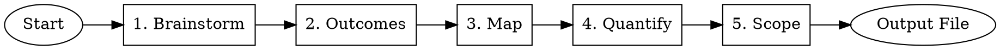

# Float Performance Review: The WHAT

## Overview

This skill guides you through documenting **what tangible impact you delivered** over the review period. You'll brainstorm work, convert activities to outcomes, map to Float's 5 business impact areas, quantify metrics, and assess scope. The final output is automatically saved to `YYYY-MM-DD-performance-review-answers/what-answer.md`.

## When to Use

Use this skill when:
- Starting your Float performance review preparation
- You need to document tangible impact and business outcomes
- You want to map work to Float's 5 business impact areas
- You're answering: "What was your tangible impact over the last 6 months?"
- **Always complete this BEFORE float-performance-how**

## When NOT to Use

Don't use this skill when:
- You're articulating strengths, values, or building narrative examples (use float-performance-how)
- You're already past the impact documentation phase
- You don't work at Float (this is Float-specific)
- You're reviewing someone else (this is for self-assessment)
- You haven't started the work yet (this documents past impact)

## Review Question

**What was your tangible impact over the last 6 months? Include specific outcomes and deliverables that demonstrate impact in one or more of Float's five impact areas.**

## Quick Reference

| Phase | Goal | Key Output |
|-------|------|------------|
| **1. Brainstorm** | Generate comprehensive work list | Raw activity list |
| **2. Connect** | Convert activities to outcomes | Activity + outcome pairs |
| **3. Map** | Link to business impact areas | Outcomes mapped to Float's 5 areas |
| **4. Quantify** | Add metrics and validation | Validated, quantified outcomes |
| **5. Assess Scope** | Determine breadth/depth | Outcomes ranked by significance |

**Process Flow:**



## Common Mistakes

| Mistake | Fix |
|---------|-----|
| **Listing activities without outcomes** | Ask "What changed?" Add metrics showing the result |
| **Using vague metrics** | Specify exact numbers: "Reduced latency by 75% (800ms → 200ms)" |
| **Claiming team credit as personal** | Clarify: "I led X, which enabled the team to achieve Y" |
| **Forgetting business context** | Connect technical work to customer/revenue/operational outcomes |
| **Skipping quantification** | Add metrics: percentages, time saved, customers affected, $ value |
| **Not mapping to impact areas** | Explicitly tag each outcome with 1-2 of Float's 5 impact areas |

## How to Use

Tell Claude:

```
I want to document my impact for Float's performance review. 
Let's start with float-performance-what to capture what I accomplished 
and the business outcomes. Help me brainstorm my work from [review period].
```

Claude will guide you through all 5 phases, referencing detailed process guidance in PROCESS.md as needed.

## Reference Files

For detailed guidance, see:

- **FRAMEWORKS.md** - Float's 5 Business Impact Areas
- **PROCESS.md** - Detailed step-by-step for all 5 phases
- **EXAMPLES.md** - Weak/Better/Great example comparisons
- **OUTPUT-FORMAT.md** - File output requirements and structure

## Success Criteria

You're done when you have:

- ✓ Comprehensive list of outcomes (not just activities)
- ✓ Each outcome mapped to Float's business impact areas
- ✓ Metrics and quantification for each outcome
- ✓ Your specific contribution clearly stated
- ✓ Scope assessed for each outcome
- ✓ Structured summary saved to `what-answer.md`

## Next Step

After completing this skill, move to **float-performance-how** to articulate strengths, connect to values, and calibrate to your level.
